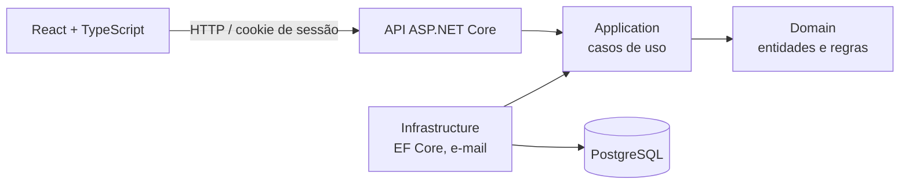

# Gerenciador Financeiro

Sistema web de **finanças pessoais e familiares**: contas individuais e conjuntas, transações
(inclusive recorrentes e parceladas), categorias, metas, notificações e relatórios em PDF e Excel.

Back-end em **ASP.NET Core 8** com **Entity Framework Core** e **PostgreSQL**, organizado em
camadas (Clean Architecture / DDD), e front-end em **React + TypeScript**. Tudo roda num único
contêiner **Docker**.


<!-- Prints das telas: salvar em docs/imagens/ e descomentar

-->

## Funcionalidades

- **Contas individuais e conjuntas**: convite para participar de uma conta conjunta, permissões
  por membro, saldo inicial, saldo real (só transações concluídas) e saldo previsto.
- **Transações**: entradas e saídas com status (pendente, concluída, atrasada), "conta paga",
  filtros e ordenação por várias colunas.
- **Recorrências**: séries mensais ou semanais, parcelas, prévia dos próximos lançamentos e
  "excluir só esta / esta e as próximas".
- **Categorias e subcategorias** personalizáveis.
- **Metas** com progresso calculado pelas transações vinculadas.
- **Notificações**: saldo baixo, gasto acima do normal, conta atrasada, lembrete de vencimento
  e prazo de meta, com preferências por membro.
- **Relatórios**: PDF gerado no back-end (QuestPDF) e Excel gerado no front (ExcelJS).
- **Conta e segurança**: cadastro, login, "esqueci a senha" com código por e-mail e alteração de
  senha.

## Arquitetura

```
GerenciadorContaFamiliar/                     API (controllers, middleware, PDFs, Program.cs)
├── GerenciadorContaFamiliar.Domain/          entidades e regras de negócio, sem dependências
├── GerenciadorContaFamiliar.Application/     casos de uso, DTOs, interfaces dos repositórios
└── GerenciadorContaFamiliar.Infrastructure/  EF Core, migrações, repositórios, e-mail
GerenciadorContaFamiliar.Tests/               testes automatizados (xUnit + NSubstitute)
frontend/                                     React 19 + TypeScript + Vite
```



- **Domain** guarda as regras: saldo, mudança de status, progresso da meta, geração das
  ocorrências de uma recorrência. Não conhece banco nem HTTP.
- **Application** orquestra os casos de uso e depende só de interfaces.
- **Infrastructure** implementa essas interfaces com EF Core (PostgreSQL) e MailKit.
- **Controllers finos**: recebem o DTO, pegam o membro logado do token e chamam o caso de uso.
  Um middleware traduz as exceções em respostas HTTP (400, 401, 403, 404, 409).

## Segurança

- Autenticação com **JWT** guardado em **cookie HttpOnly** (o token não fica acessível ao
  JavaScript); trocar a senha derruba as sessões abertas.
- Senhas com hash **BCrypt**; código de recuperação de senha guardado só como hash, com validade
  e limite de tentativas.
- **Rate limiting** por IP no login, no cadastro, na recuperação de senha e no total de
  requisições.
- Segredos fora do repositório: **User Secrets** em desenvolvimento e variáveis de ambiente em
  produção. A API não inicia se faltar algum.
- Consultas pelo EF Core (parametrizadas), com testes de **SQL injection**.
- O contêiner roda com usuário sem privilégios.

## Tecnologias

| Camada | Tecnologias |
|---|---|
| Back-end | C#, ASP.NET Core 8, Entity Framework Core 8, Npgsql, JWT, BCrypt, MailKit, QuestPDF, Swagger |
| Banco | PostgreSQL |
| Front-end | React 19, TypeScript, Vite, React Router, Axios, ExcelJS |
| Testes | xUnit, NSubstitute |
| Infra | Docker (build multi-stage), Docker Compose, Render, Neon |
| Ferramentas | Git, Visual Studio, VS Code, Postman, Claude Code |

## Como rodar

### Com Docker (mais simples)

Sobe a aplicação e um PostgreSQL descartável:

```bash
cp .env.exemplo .env   # preencher SENHA_BANCO_LOCAL e JWT_LOCAL (64+ caracteres aleatórios)
docker compose -f docker-compose.local.yml up --build -d
```

Acesse <http://localhost:8080>. Para apagar tudo, inclusive o banco:
`docker compose -f docker-compose.local.yml down -v`.

### Em modo de desenvolvimento

Pré-requisitos: .NET 8 SDK, Node.js 24 e PostgreSQL.

```bash
# API (porta 5237)
cd GerenciadorContaFamiliar
dotnet user-secrets set "ConnectionStrings:DefaultConnection" "Host=localhost;Port=5432;Database=GerenciadorFamiliar;Username=postgres;Password=<sua senha>"
dotnet user-secrets set "JwtSettings:SecretKey" "<64+ caracteres aleatórios>"
dotnet tool restore
dotnet tool run dotnet-ef database update --project GerenciadorContaFamiliar.Infrastructure --startup-project .
dotnet run

# Front-end (porta 5173, com proxy para a API)
cd frontend
npm install
npm run dev
```

Sem SMTP configurado, em desenvolvimento o código de "esqueci a senha" aparece no console da API.
A documentação interativa da API fica em `/swagger`.

### Testes

```bash
dotnet test GerenciadorContaFamiliar.Tests
```

Cobrem as regras do domínio (saldo, status, metas, recorrência, contas conjuntas, senha), casos de
uso com repositórios falsos e a proteção contra SQL injection.

## Desenvolvimento assistido por IA

O projeto foi desenvolvido em duas fases.

**Fase 1, desenvolvimento manual (jul–set/2026):** construí a base do sistema: a
arquitetura em camadas (Domain, Application, Infrastructure), a persistência com EF Core e
PostgreSQL, os casos de uso, os controllers e o middleware de exceções. A autenticação com JWT e
BCrypt, o CORS e a primeira versão do front-end em React tiveram auxílio parcial de IA.

**Fase 2, com o Claude Code (out/2026):** usei o **Claude Code** como par de programação para
evoluir o sistema num fluxo estruturado. Cada funcionalidade nasce como uma especificação que eu
reviso, vira um plano de implementação em etapas e só depois é codificada, com revisão de padrão
e qualidade ao fim de cada etapa. Nessa fase entraram as recorrências, as notificações, os
relatórios em PDF e Excel, o saldo real, a recuperação de senha, o reforço de segurança, os testes
automatizados e o deploy com Docker. As decisões de regra de negócio, a revisão e a aprovação de
cada entrega continuaram sendo minhas.

As especificações e os planos ficam em [`docs/Planos/`](docs/Planos/), e o acompanhamento em
[`docs/estado-do-projeto.md`](docs/estado-do-projeto.md) e [`docs/pendencias.md`](docs/pendencias.md).

## Próximos passos

Melhorias conhecidas estão em [`docs/pendencias.md`](docs/pendencias.md): ampliar a cobertura de
testes, controle de concorrência no saldo de contas conjuntas e ajustes no fluxo de recuperação de
senha.

## Autor

**Pedro Rotta**, estudante de Sistemas de Informação na Unoeste.
[LinkedIn](https://www.linkedin.com/in/pedro-rotta-5985a0237) · [GitHub](https://github.com/Pedro-Rotta)

## Licença

Código sob a licença [MIT](LICENSE). Os relatórios em PDF usam o
[QuestPDF](https://www.questpdf.com/license/) (licença Community).
